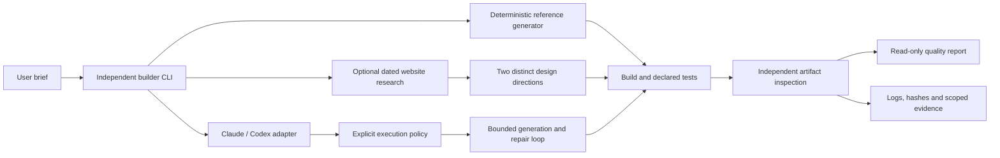

# Architecture

`core.builder_cli` exposes creation, checks, cleaning, provider diagnostics, research,
design and agent runs. `builders.scaffold` validates a structured brief and stages a new
workspace; it never overwrites an existing directory. The user task is retained in
`builder-brief.json`. Templates are limited reference implementations, not unrestricted
natural-language synthesis. `ai_generated` remains false.

`core.pipeline` constructs a builder-specific skill context, invokes a provider adapter,
runs predeclared checks and permits zero to three repair attempts. Minecraft context
loads only requested loader specialties. No verification claim follows an agent exit code:
machine-readable provider completion, actual checks, nonempty artifacts and independent
output inspection are separate requirements. Browser, game runtime and production readiness
remain distinct scopes. Pipeline state is saved on transitions and interruption.

`core.process` strips credential/environment inheritance, supplies a temporary home,
bounds time/output, avoids shell interpolation and terminates descendants. POSIX uses
process groups; Windows assigns a suspended process to a kill-on-close Job Object before
resuming it. Docker execution requires a preinstalled digest-pinned image, non-root user,
limited CPU/memory/PIDs, read-only root filesystem, dropped capabilities and no network by
default. It mounts only the explicit workspace. Owned containers are removed on cancellation.
The Docker path has policy/unit evidence, but no local live-container verification.

Host execution is an explicit `--trusted-local` choice for reviewed code. It is **not isolation**.
No credentials are automatically mounted/passed to provider containers. Safe authenticated
provider access/brokering is unfinished; the fully autonomous product is therefore not ready.

`distribution.installer` validates portable paths, record shapes, hashes and module namespaces.
It rejects symlinks and Windows reparse points, refuses adoption of unmanaged files, locks
operations and journals old/new bytes before mutation. Recovery validates the entire journal
and refuses subsequent user edits. Exact root-owned macOS `/var`, `/tmp`, `/etc` aliases are
normalized to their verified `/private` targets; user links remain rejected. This is not a
defense against an already malicious same-user process racing filesystem changes.

`distribution.bundle` packages one builder's skills, executable core, selected templates,
Cleaner and brief into a reproducible ZIP with exact checksums. Installed runtimes disable
bytecode writes so normal launcher use does not leave module-owned cache files after removal.
Archives are integrity-checked, not publisher-signed.

`builders.research` collects only public HTTPS HTML/CSS. DNS results must all be public,
the connected IP is pinned while TLS hostname verification is preserved, redirects are
revalidated, and per-site subprocesses have deadlines/output limits. No remote JavaScript,
font binary, account, screenshot or full page copy is executed/stored. Findings describe
the sample, not traffic, visual quality or future popularity.

`quality.cleaner` is self-contained and read-only. Python AST and local reference/asset
checks supplement conservative text heuristics. Proposals contain diffs and preimage hashes;
there is no automatic apply/delete operation. Visual QA runs separately in Chromium/axe.

The original `framework/` router/planner and `scripts/workflow.py` remain portable offline
utilities. They do not themselves call AI models or validate evidence strings.
